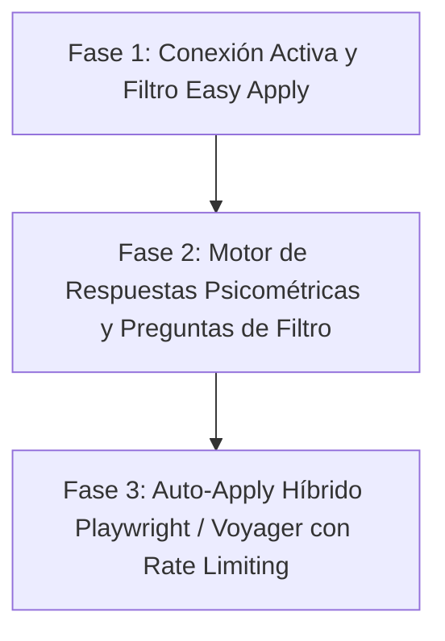

# 🤖 AI Job Hunter Bot V7 — Autonomous Tech Recruiter & Job Hunter

Bot autónomo de búsqueda, filtrado, postulación y networking en **Data Science, Artificial Intelligence, Machine Learning, Business Intelligence & Finanzas** para Ecuador (Machala / El Oro / Guayaquil / Nacional) y Trabajo Remoto Global.

- **Candidato:** Erick Flores Zambrano — Economista (UTMACH) & Ing. en Ciencia de Datos e IA (UG)  
- **Correo Principal:** `erickflores6655@gmail.com`  
- **Infraestructura:** GitHub Actions CI/CD (100% Gratuito y Serverless, 3 ejecuciones diarias) + Ejecución Local en Windows  
- **Canal de Notificaciones:** Telegram Bot ([@erick_job_alerts_bot](https://t.me/erick_job_alerts_bot))  

---

## 📄 CVs Maestros Estandarizados (Permanentes)

Para asegurar consistencia en todas las postulaciones futuras, el sistema cuenta con **tres CVs base universales** en `data/`:

| Archivo | Ámbito de Aplicación | Enfoque Principal |
|---|---|---|
| `data/CV_Erick_Flores_Pasantias.pdf` | **Pasantías Universitarias, Banca, Finanzas y Sector Público** | Prácticas preprofesionales, análisis macro/micro, riesgo crediticio, econometría, SQL y Power BI. |
| `data/CV_Erick_Flores_Data_AI.pdf` | **Empleos Tech, Ingeniería de Datos, Data Analyst & ML** | Python, FastAPI, PyTorch, modelos predictivos, pipelines ETL, arquitecturas en la nube. |
| `data/CV_Erick_Flores_EN.pdf` | **Vacantes Internacionales y Remoto Global en Inglés** | ATS en inglés optimizado para roles de Data Science, Machine Learning y Data Annotation. |

---

## ⚡ ¿Qué hace el sistema en cada ciclo?

El pipeline se ejecuta automáticamente cada día en **GitHub Actions** (08:00, 13:00 y 18:00 hora Ecuador) y de forma local con `python main_v6.py`:

1. **Scraping Multi-Canal (130+ ofertas por ciclo):**
   - 🇪🇨 **Ecuador Especializado (`src/scrapers/ecuador_scrapers.py`):**
     - **Computrabajo Ecuador:** Scraper en vivo de pasantías, sistemas, analítica y vacantes en El Oro / Machala.
     - **Banca Nacional:** Monitoreo activo de BIESS, Banco Pichincha, Banco Guayaquil, Banco de Machala y Produbanco.
     - **Agroexportación Costa:** Convocatorias de Industrial Pesquera Santa Priscila S.A., Reybanpac y cbc Ecuador (Grupo Mariposa).
   - 🔵 **LinkedIn (Ecuador & LATAM):** Búsqueda con geolocalización y Voyager API.
   - 🌐 **Bolsas Remotas Globales:** GetOnBoard (LATAM), Remotive, RemoteOK, Jobicy, WeWorkRemotely, WorkingNomads.

2. **Filtrado Inteligente con MatchEngine:**
   - Valida roles afines a Data, AI, BI, Python, SQL, Econometría y Pasantías.
   - Descarta puestos senior (+8 años de experiencia), soporte básico y áreas no afines.

3. **Memoria Persistente y Deduplicación (`MemoryStore` & `FunnelDB`):**
   - Evita duplicados y previene loops de spam en Telegram manteniendo registro de ofertas enviadas (`applied_success`) y despachadas para acción manual (`notified_manual`).
   - Base de datos relacional SQLite en `data/funnel.db` con registro de fecha, empresa, enlace y estado.

4. **Postulación Activa Híbrida:**
   - **Envío Directo por Correo (Cold-Email con PDF adjunto):** Envía correo formal con carta personalizada y CV adjunto a correos de RRHH verificados (`pasantias.biess@biess.fin.ec`, `smunoz@santa-priscila.com`, `rrhh@bancomachala.com`). Cabecera `Reply-To` dirigida a `erickflores6655@gmail.com`.
   - **Postulación Asistida 1-Tap a Telegram:** Para ofertas que requieren login corporativo (Oracle Cloud, SuccessFactors, Computrabajo), el bot genera una tarjeta interactiva con enlace limpio y carta de presentación redactada lista para copiar y pegar.

5. **Networking Automatizado en LinkedIn:**
   - Envío orgánico y seguro de invitaciones de conexión a reclutadores de IA y Datos en la región.

---

## 🚀 Plan para Llevar la Auto-Postulación en LinkedIn al "Siguiente Nivel"

Para automatizar la postulación en LinkedIn a escala sin riesgo de suspensión de cuenta, se establece la siguiente hoja de ruta de tres fases:



### Fase 1: Sesión Persistente y Filtrado Exclusivo de "Easy Apply"
- **Objetivo:** Filtrar empleos con el tag nativo `f_LF=f_AL` (Easy Apply) que se puedan procesar dentro del ecosistema de LinkedIn.
- **Herramienta:** Uso de sesión activa mediante `linkedin-mcp` y almacenamiento de cookies locales para operar con tu perfil real (`Erick Flores Zambrano`).

### Fase 2: Motor Inteligente de Preguntas de Formulario (Question Answering Engine)
- En Easy Apply, LinkedIn suele desplegar modales de 2 a 5 pasos preguntando:
  - Teléfono (`+593 096 395 1193`)
  - Años de experiencia con Python/SQL (`2-3 años`)
  - Autorización legal para trabajar en Ecuador (`Sí`)
  - Nivel de inglés (`Profesional / B2`)
  - Salario esperado (`$600 - $1,200 USD`)
- **Implementación:** Archivo de respuestas maestras estructurado en `data/screening_answers.json` + motor de heurística LLM (Gemini) para inferir respuestas de selección múltiple automáticamente.

### Fase 3: Ejecución Playwright Headless con Rate Limiting Riguroso
- **Seguridad Antiban:** Máximo **10 a 15 postulaciones Easy Apply al día**, espaciadas con retardos aleatorios tipo humano (20 a 45 segundos por postulación).
- **Subida de CV Dinámica:** Si la vacante es internacional/inglés, adjunta `data/CV_Erick_Flores_EN.pdf`; si es en español, adjunta `data/CV_Erick_Flores_Data_AI.pdf`.
- **Verificación de Confirmación:** Valida el modal "Postulación enviada" antes de marcar como exitosa en `funnel.db`. Si surge un captcha o pregunta compleja no mapeada, aborta y te manda el enlace a Telegram para que no pierdas la oferta.

---

## 🛠️ Estructura del Repositorio

```
├── .github/workflows/
│   └── job_hunter.yml          ← Cron 3x/día en GitHub Actions (Serverless)
├── data/
│   ├── CV_Erick_Flores_Pasantias.pdf   ← CV Universal Pasantías y Banca
│   ├── CV_Erick_Flores_Data_AI.pdf     ← CV Universal Data, AI & Engineering
│   ├── CV_Erick_Flores_EN.pdf          ← CV Universal Inglés / Remoto
│   ├── applied_jobs.json               ← Registro de deduplicación
│   └── funnel.db                       ← Base de datos SQLite de aplicaciones
├── src/
│   ├── scrapers/
│   │   ├── ecuador_scrapers.py ← Computrabajo EC, Banca y Agroexportación
│   │   ├── linkedin_scraper.py ← LinkedIn Voyager API
│   │   ├── api_scrapers.py     ← GetOnBoard, Remotive, RemoteOK, Jobicy
│   │   └── latam_scrapers.py   ← WeWorkRemotely, WorkingNomads
│   ├── appliers/
│   │   ├── base_applier.py     ← ApplyStatus (SUBMITTED, NEEDS_MANUAL, ERROR)
│   │   ├── greenhouse_applier.py
│   │   ├── lever_applier.py
│   │   └── linkedin_applier.py
│   ├── filters/match_engine.py
│   ├── memory/memory_store.py
│   ├── memory/funnel_db.py
│   └── notifications/telegram_notifier.py
├── execute_applications.py     ← Script de despacho y postulación inmediata
├── main_v6.py                  ← Orquestador general del ciclo
├── OPORTUNIDADES_EC.md         ← Listado maestro de 12 ofertas puntuadas
└── requirements.txt
```

---

## 💻 Ejecución Local

```bash
# 1. Ejecutar ciclo completo de búsqueda y matching
python main_v6.py

# 2. Ejecutar postulación activa y despacho a Telegram
python execute_applications.py

# 3. Ejecutar solo en modo prueba (sin enviar correos ni postulaciones)
python main_v6.py --dry-run
```
